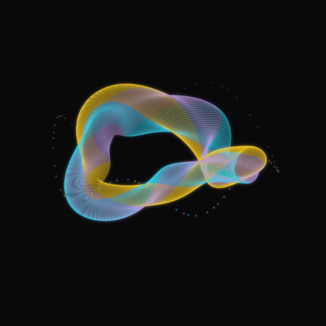
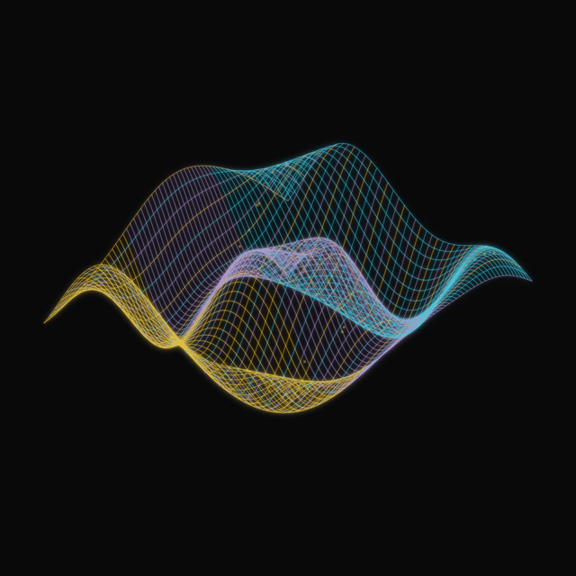
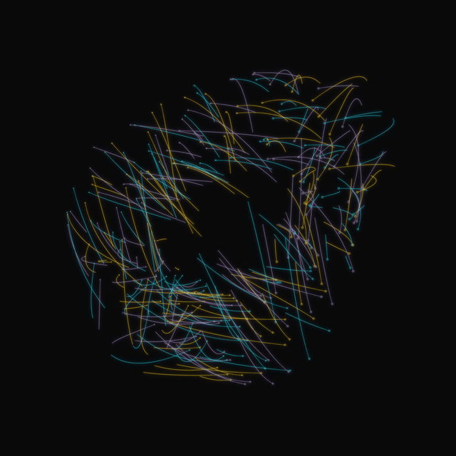
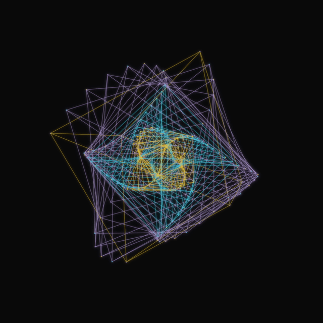

<div align="center">


# Sema Fractals

**Fractal experiments and glowing, seamless animations made with Sema.**

[](https://sema-lang.com)
[](LICENSE)

[**Gallery**](#showcase) · [**Run locally**](#setup-and-usage) · [**Sema docs**](https://sema-lang.com/docs/)

</div>

Fractal experiments and periodic 3D animations, with Sema source, stills, GIF previews, and MP4 renders.

## Showcase

| Kinetic Loom | Wave Atlas |
| --- | --- |
|  |  |
| **Comet Ballet** | **Prism Engine** |
|  |  |

These four are six-second parametric animations at 1920×1920 and 60 fps, with 3840×3840 supersampling and bloom. GIF previews run at 20 fps.

```sh
git clone https://github.com/sema-lisp/sema-fractals.git
cd sema-fractals/evolving-scenes
sema --no-llm animate.sema        # Kinetic Loom
sema --no-llm animate-three.sema  # Wave Atlas, Comet Ballet, Prism Engine
```


## Setup and usage

Install the tools on macOS:

```sh
brew install helgesverre/tap/sema-lang librsvg ffmpeg
sema --version
rsvg-convert --version
ffmpeg -version
```

On other systems, install [Sema](https://github.com/sema-lisp/sema#installation), librsvg's `rsvg-convert`, and FFmpeg with H.264 encoding support. All tools must be on PATH. These scripts run with `--no-llm`; no API key is needed.

From a cloned repository, choose a scene:

```sh
cd evolving-scenes
sema --no-llm render.sema              # one Kinetic Loom still
sema --no-llm animate.sema             # full Kinetic Loom video + GIF
cd wave-atlas                         # or comet-ballet / prism-engine
sema --no-llm render.sema              # one still of this scene
sema --no-llm animate.sema             # this scene's video + GIF
```

Each renderer writes its outputs into its working directory. Run scripts from the directory shown; relative library paths depend on it. `prepare-three.sema`, run from `evolving-scenes/`, refreshes the three child directories from the parent scene templates.

GIFs loop automatically. Enable repeat in your video player to loop the MP4s.

Full-resolution bloom can take tens of minutes. `animate-three.sema` runs three processes concurrently and uses more CPU and memory; use the individual commands for lower peak resource use. Progress and encoder messages go to `render.log` and `encode.log`; completed checks are recorded in `verification.json`.

Sema generates the geometry and SVG bloom layers. `rsvg-convert` rasterizes the frames; FFmpeg encodes the videos.

## Finished animations

The high-resolution files are in `memory-fractals/`:

- `address-lace-1920-60fps-loop.mp4`
- `signed-braid-1920-60fps-loop.mp4`
- `phase-coral-1920-60fps-loop.mp4`

Each contains a four-second cycle at **1920 × 1920, 60 fps**, with a matching `*-bloom-preview.gif` at 20 fps.

The renderer draws at 3840 × 3840 before downsampling. Three Gaussian blur scales produce bloom in linear RGB.

## Sema implementation

All custom code in the current pipeline is Sema:

- `prepare-native.sema`: creates the animated geometry library from the original recursive constructions.
- `animated-geometry.sema`: parameterized recursive constructions.
- `svg-canvas.sema`: mutable path buffers, SVG batching, palette, bounds checks, and bloom definitions.
- `render-native.sema`: periodic timing, per-frame geometry, PNG generation, binary stdout, and progress reporting.
- `build-native.sema`: bundles the libraries and compiles the tool to Sema bytecode.
- `animate.sema`: runs three independent pipelines concurrently using Sema async tasks, encodes GIF previews, and verifies MP4s.
- `stress-native.sema`: deeper recursion benchmarks, with no rasterizer involved.
- `verify-media.sema`: full video decode checks and direct GIF header/loop inspection using Sema bytevectors.

## Reproduce

```sh
cd sema-fractals/memory-fractals
sema --no-llm prepare-native.sema
sema --no-llm build-native.sema
sema --no-llm animate.sema
```

Render one construction or a longer cycle:

```sh
FRACTAL_NAME=signed-braid FRACTAL_FRAMES=480 sema --no-llm animate.sema
```

The frame rate remains 60 fps; 480 frames produce eight seconds. To generate only a high-resolution still:

```sh
FRACTAL_NAME=phase-coral FRACTAL_MODE=preview sema --no-llm native-tool.semac
```

Run geometry stress checks:

```sh
sema --no-llm stress-native.sema
```

## Evolving scenes

`evolving-scenes/` contains the four showcase scenes, including Kinetic Loom: a non-fractal, six-second, 1920-square, 60-fps ribbon animation with bloom. See its README for the Sema source and reproduction commands.

## Earlier experiments

julia.sema and julia.png contain the first Julia-set experiment. splash-fractals/ contains the earlier escape-time constructions, images, and animations.

See [construction notes](memory-fractals/notes.md) for the fractal rules.
